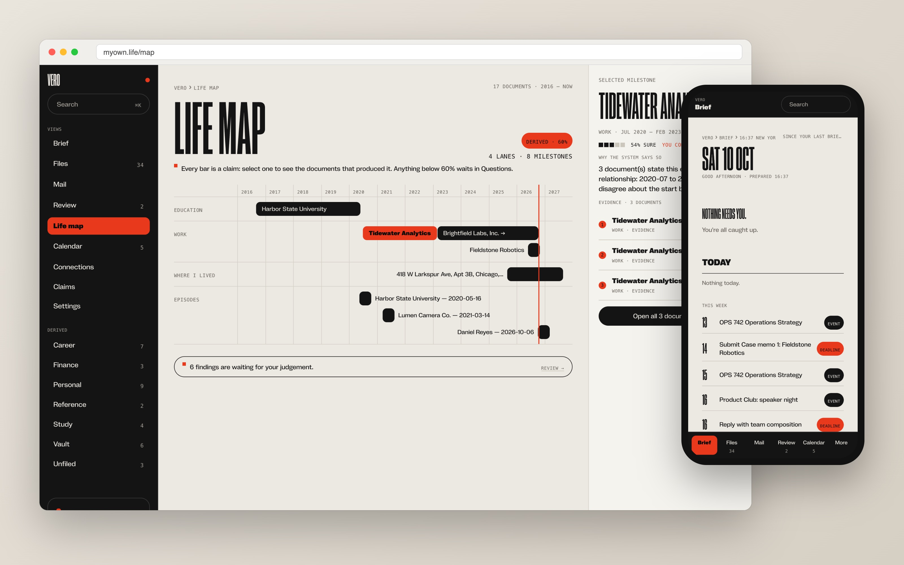

# Vero

**A personal archive AI can use, with a hard line around what it must never see**

**[Read the case study →](https://github.com/CB-viberrr/portfolio/blob/main/case-studies/vero.md)** · [Live](https://myown.life) (private, passkey sign-in)

- **An archive that files itself.** Every document becomes typed, dated, sourced metadata, and from it come a career
  timeline, claims, deadlines and an entity graph. Nobody files anything.
- **AI-native, with a boundary that can't be talked around.** Local rules send passports, tax forms and diaries to a
  vault before any third-party call. The vault is never embedded, and agents connected over MCP see only its metadata.
- **Production rigour:** 1,398 commits and 370 merged PRs in 28 active days, 348 test files and 120 migrations. On a
  30-query retrieval eval, recall@10 is 1.00, and reranking lifts MRR from 0.85 to 0.98 while cutting decoy leakage
  from 6% to 0%.

---
Screens show a demo archive of a fictional person. This repository is a showcase: the code is private. A walkthrough is available on request.
More work: [portfolio](https://github.com/CB-viberrr/portfolio) · © 2026 Charles Bingaman
